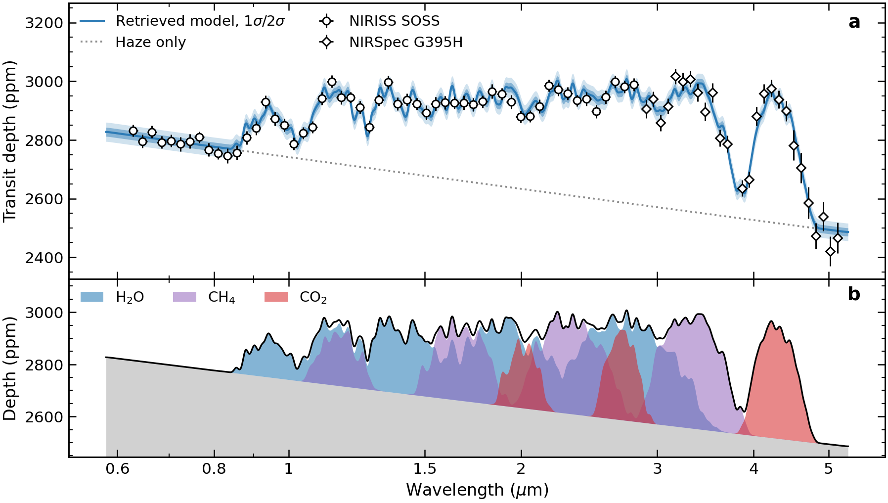
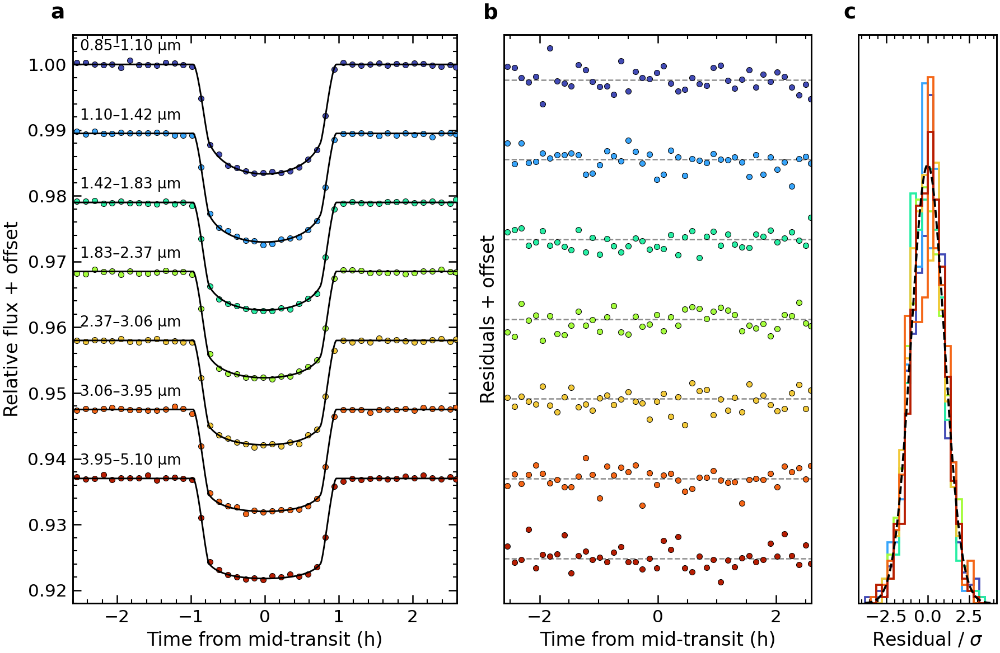
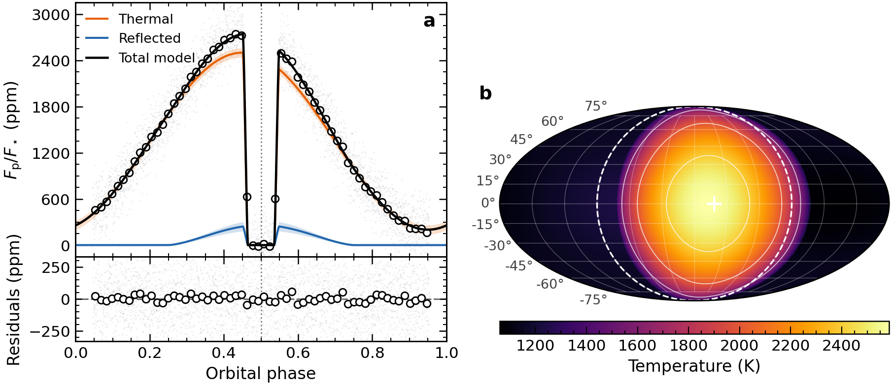
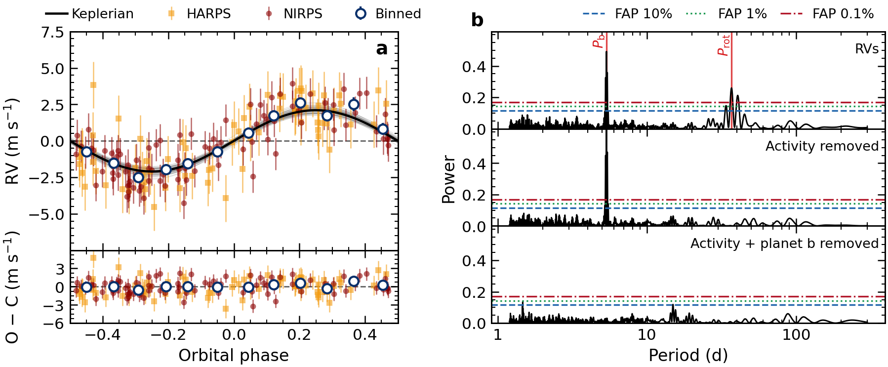
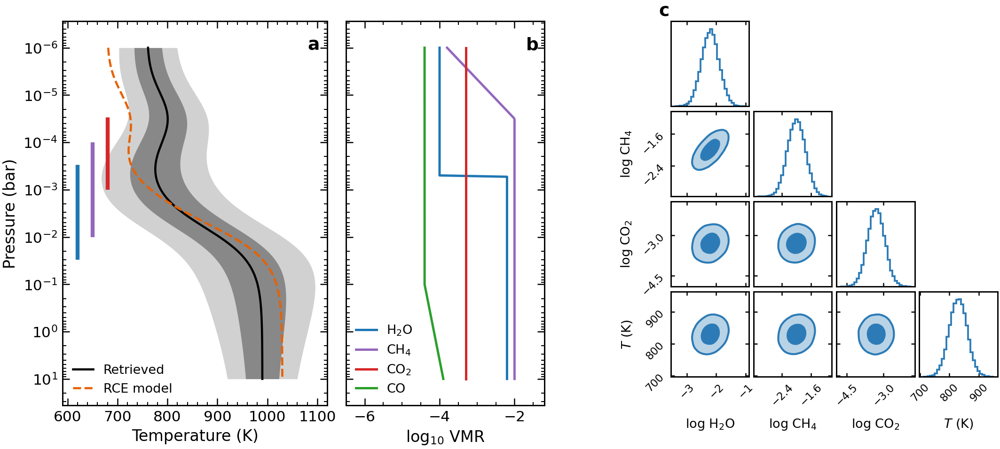
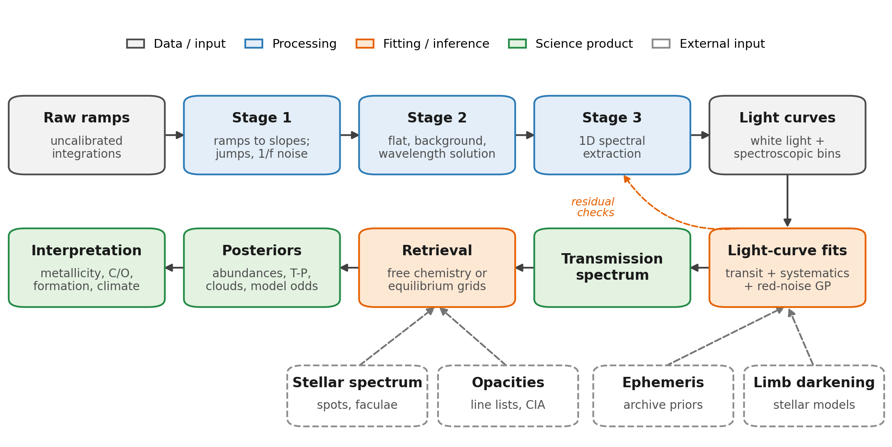
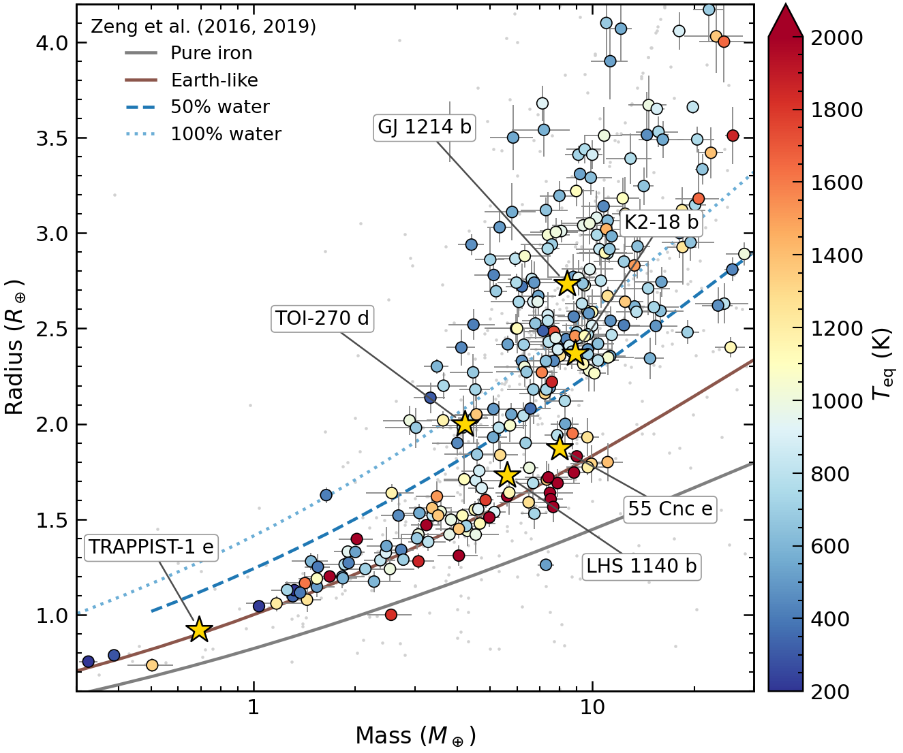

<div align="center">

<h1><code>figures4astro</code></h1>

**Publication-ready matplotlib figures for exoplanet science, plus a Claude skill that makes them.**

</div>

`figures4astro` is a small plotting module (`exoplot.py`) and an AI-agent skill
for the figures exoplanet papers actually need: transit and eclipse light
curves with residuals, spectroscopic light-curve stacks, transmission and
emission spectra with retrieved models, phase curves and maps, T–P profiles
and posteriors, radial velocities, mass–radius diagrams, population
spectral stacks, and pipeline flow charts.

<br>

### Transmission spectrum with retrieved model and species contributions


### Spectroscopic light curves, residuals and residual distributions


### Phase curve with thermal and reflected components, and a temperature map


### Radial velocities: phase fold, O − C, and periodograms as signals are removed


### Temperature–pressure profile, abundance profiles and posteriors


### Analysis flow chart: a JWST time-series pipeline from raw ramps to atmospheric constraints


### Mass–radius diagram (NASA Exoplanet Archive + Zeng et al. 2016, 2019)


The mass–radius panel uses real planets from the NASA Exoplanet Archive
(`pscomppars`, masses measured at > 5σ and radii at > 12σ). The other panels use
synthetic data (the flow chart is a generic pipeline) built to look physical: limb-darkened transits integrated over
the stellar disk, molecular bands at their true wavelengths, and an astropy
Lomb–Scargle periodogram.

<br>

## The style in eight rules

1. Closed box, ticks inward on all four sides, minor ticks on.
2. Data are open circles with black edges and no error-bar caps; unbinned data sit underneath, faint and rasterized, and never set the axis limits.
3. Every fit gets a residual panel sharing x, with no gap.
4. Models are lines; uncertainty is 1σ/2σ shading in the model's own hue.
5. Colours keep one meaning per paper: H₂O blue, CO₂ red, CH₄ purple, CO green; dayside orange, nightside blue; NIRPS dark red, HARPS orange.
6. Log wavelength axes with plain-number ticks.
7. Figures are drawn at printed column width (AAS, A&A, MNRAS, Nature), so the fonts come out at 7–9 pt.
8. Every export writes PDF + PNG + SVG with editable text.

## Repository layout

```
figures4astro/                  # the skill (Claude Code / Claude app)
├── SKILL.md                    # when to use it, workflow, rules
├── references/
│   ├── plot-types.md           # a recipe per figure type, with the paper figures that inspired it
│   ├── api.md                  # exoplot function reference
│   ├── design-theory.md        # geometry, frames, marks, colour, typography, export
│   ├── common-patterns.md      # offsets, insets, broken axes, shared colorbars, legends
│   └── demos.md                # the 24 source papers, figure by figure
└── scripts/
    ├── exoplot.py              # style + helpers (numpy + matplotlib only)
    └── demo_gallery.py         # one synthetic example of every figure type
examples/showcase.py            # builds gallery/ (this README)
gallery/                        # README images
```

## Quick start

```python
import matplotlib
matplotlib.use("Agg")
import matplotlib.pyplot as plt
import exoplot as xp            # copy figures4astro/scripts/exoplot.py next to your script

xp.use_style()                  # family="serif" or usetex=True to match LaTeX
fig, axes = xp.flux_residual_axes(ncols=2, size=xp.figsize("aas", "double", 0.38))
xp.plot_lightcurve(axes[0, 0], axes[1, 0], t, flux, t_model, f_model, f_at_data,
                   err=err, bin_width=0.1, shade=[(-0.8, -0.55), (0.55, 0.8)])
xp.finalize(fig, "figures/white_light")      # writes .pdf, .png and .svg
```

Regenerate the gallery:

```bash
python examples/showcase.py              # needs numpy, scipy, matplotlib, astropy, corner
python figures4astro/scripts/demo_gallery.py /tmp/demo   # quick synthetic check of every builder
```

## Use it as an AI-agent skill

**Claude Code** (CLI, desktop app, IDE extensions):

```bash
git clone https://github.com/wasnaqvi/figures4astro.git ~/figures4astro
mkdir -p ~/.claude/skills
ln -s ~/figures4astro/figures4astro ~/.claude/skills/figures4astro
```

**Claude app (claude.ai)**: zip the `figures4astro/` folder and upload it under
*Settings → Capabilities → Skills*.

Then ask for a figure ("make a transmission-spectrum figure for ApJ from
`spectrum.csv`"), and the agent follows the recipes and checks the render before
it hands the figure back.

## Credits and license

The repository started as a fork of
[ChenLiu-1996/figures4papers](https://github.com/ChenLiu-1996/figures4papers)
by Chen Liu (CC BY-NC 4.0). Its generic bar/heatmap style, demos and images were
removed and replaced with exoplanet-specific conventions, code, recipes and
figures. Composition curves: Zeng et al. (2016, 2019), fetched at run time from
the author's tables. Planet data: NASA Exoplanet Archive.

Released under [CC BY-NC 4.0](LICENSE), as the original was.
